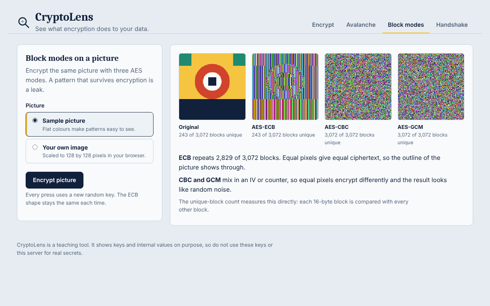
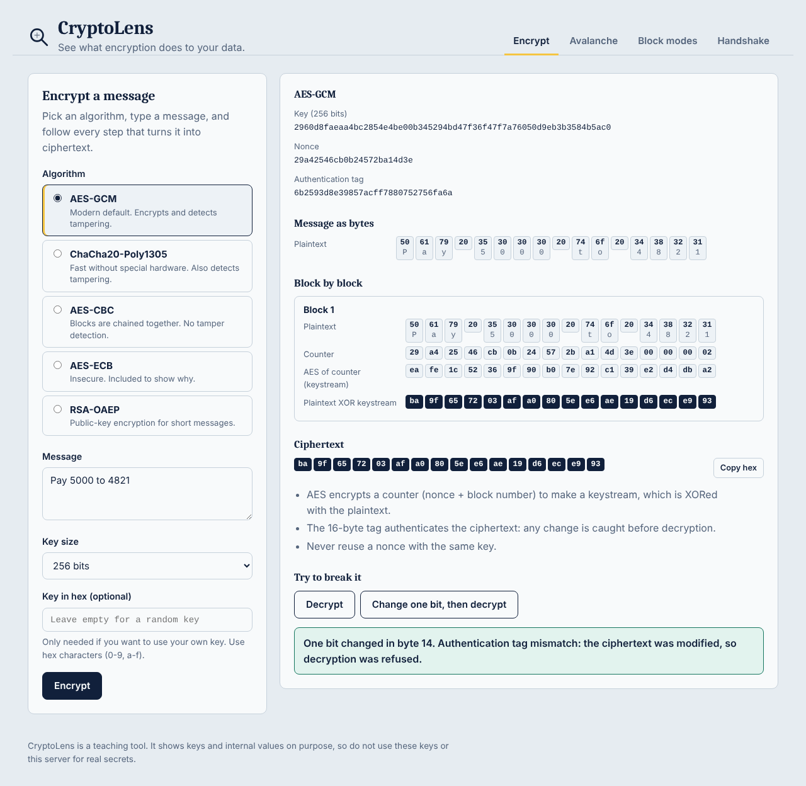
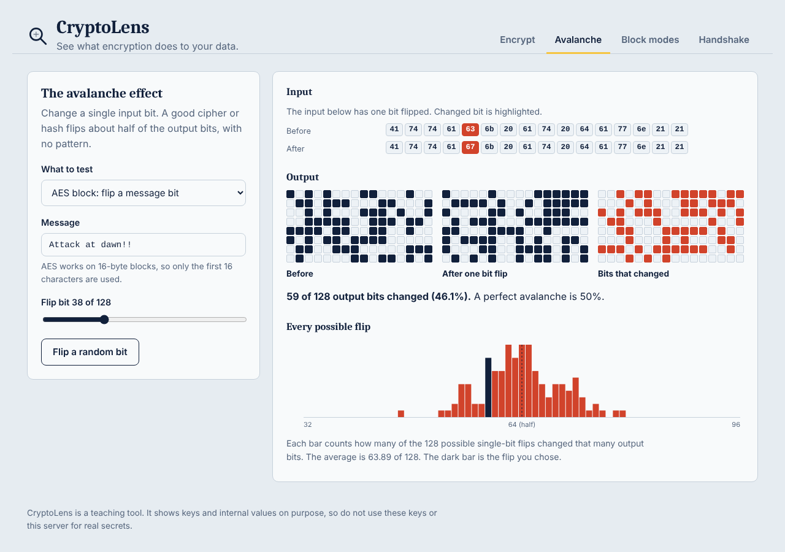
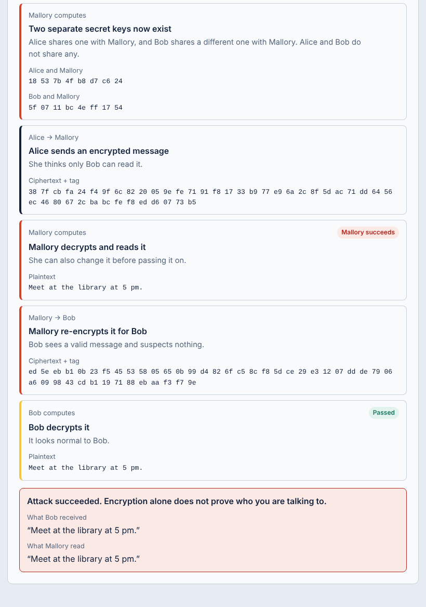
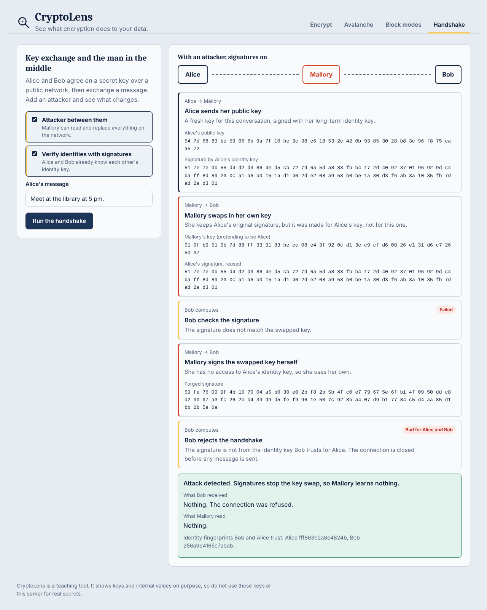

<div align="center">

# 🔍 CryptoLens

### See what encryption actually does to your data

An interactive playground where every key, block and byte is drawn on screen.


[Screenshots](#-screenshots) · [Quick start](#-quick-start) · [How it works](#-how-it-works) · [Troubleshooting](#-troubleshooting)

<br>



<sub>The same picture, encrypted three ways. ECB still shows the shape. CBC and GCM look like noise.</sub>

</div>

> ⚠️ **Teaching tool.** CryptoLens shows keys and internal values on purpose. Do not use it to protect real data.

## 🎯 What you can do

| | Tab | You will learn that |
|:-:|---|---|
| 🔐 | **Encrypt** | AES-GCM and ChaCha20 detect tampering. CBC and ECB do not. |
| 🌊 | **Avalanche** | Changing one input bit changes about half of the output bits. |
| 🖼️ | **Block modes** | ECB leaks the pattern of a picture. CBC and GCM hide it. |
| 🤝 | **Handshake** | Encryption alone is not enough. Signatures stop a man in the middle. |

## 📸 Screenshots

### 🔐 Encrypt: follow every step, then try to break it

Pick an algorithm and see the key, nonce, tag and each block. Press **Change one bit, then decrypt** and watch AES-GCM refuse the tampered message.



### 🌊 Avalanche: one flipped bit, half the output changes

The red squares show which output bits changed. The histogram covers every possible single-bit flip.



### 🤝 Handshake: the man-in-the-middle attack

Without signatures, Mallory swaps the keys and reads the message while Bob suspects nothing.



With signatures, Bob rejects the swapped key and Mallory learns nothing.



## 🚀 Quick start

**You need:** Python 3.9 or newer and a web browser.

<table>
<tr>
<th width="50%">🪟 Windows</th>
<th width="50%">🍎 Mac / 🐧 Linux</th>
</tr>
<tr>
<td>

```powershell
python -m pip install --user -r requirements.txt
python app.py
```

Or double-click `run.bat`.

If pip is missing, run `python -m ensurepip --upgrade` first.

</td>
<td>

```bash
python3 -m venv .venv
source .venv/bin/activate
pip install -r requirements.txt
python app.py
```

Or run `./run.sh`.

</td>
</tr>
</table>

Then open **http://127.0.0.1:5050** in your browser. Stop the server with `Ctrl + C`.

**Run the tests:** `python -m unittest discover -s tests -v`

**Use another port:** `PORT=8000 python app.py` (Mac and Linux) or `set PORT=8000 && python app.py` (Windows Command Prompt).

## 🧠 How it works

```
 ┌───────────────────┐   JSON    ┌───────────────────┐   calls   ┌──────────────────────┐
 │  Browser          │ ────────▶ │  Flask API        │ ────────▶ │  cryptography        │
 │  HTML / CSS / JS  │ ◀──────── │  app.py           │ ◀──────── │  AES, RSA, X25519... │
 │  draws each step  │  results  │  returns each step│  results  │  real cryptography   │
 └───────────────────┘           └───────────────────┘           └──────────────────────┘
```

- The backend does the real cryptography and returns **every intermediate value**, not just the final ciphertext.
- The step-by-step views are rebuilt from the same primitives and **checked against the library's output** in the tests.
- The frontend is plain HTML, CSS and JavaScript. There is no build step and no database.

<details>
<summary><b>📁 Project structure</b></summary>

<br>

```
cryptolens/
├── app.py                 Flask backend: all cryptography and the JSON API
├── requirements.txt       Flask, cryptography
├── run.sh / run.bat       One-step launchers
├── screenshots/           Images used in this README
├── static/
│   ├── index.html         Page layout and the four tabs
│   ├── css/style.css      Styling (light and dark mode, mobile friendly)
│   └── js/                encrypt, avalanche, blocks, handshake, util, main
└── tests/test_api.py      Backend tests
```

</details>

<details>
<summary><b>🔌 API reference</b></summary>

<br>

All endpoints take and return JSON.

| Method and path | Purpose |
|---|---|
| `POST /api/encrypt` | `{algo, plaintext, key_bits?, key_hex?}` returns key, IV or nonce, tag, per-block steps and ciphertext |
| `POST /api/decrypt` | `{algo, key_hex, iv_hex, tag_hex, ciphertext_hex, tamper_index?}` returns plaintext, or reports detected tampering |
| `POST /api/avalanche` | `{primitive, message, bit}` returns before and after bits, the difference and a sweep over all bit flips |
| `POST /api/image-modes` | `{pixels_b64}` returns the picture encrypted with ECB, CBC and GCM, plus block statistics |
| `POST /api/handshake` | `{attacker, authenticated, message}` returns each protocol step and the outcome |
| `GET /api/health` | Status check |

</details>

<details>
<summary><b>🛡️ Security notes</b></summary>

<br>

- This is a teaching tool. It shows keys on purpose and keeps the RSA private key in server memory.
- All primitives come from the well-reviewed `cryptography` library.
- Randomness comes from `os.urandom`. Keys, IVs and nonces are fresh for every request.
- ECB is included only to demonstrate its weakness.
- The server listens on `127.0.0.1` only, so other machines cannot reach it.
- Limits: requests up to 4 MB, text up to 2000 bytes, images up to 512 x 512 pixels.

</details>

## 🧯 Troubleshooting

| Problem | Fix |
|---|---|
| `python` is not recognized | Reinstall Python from python.org and tick **Add python.exe to PATH**. Or try `py` instead. |
| `No module named pip` | Run `python -m ensurepip --upgrade`. |
| `No module named cryptography` | Run `python -m pip install --user -r requirements.txt` with the same `python` that starts the app. |
| `Access is denied` creating files or `.venv` | The folder is protected. Copy the project to a folder you own, such as `Documents`, and run it there. |
| Key error about hex characters | Leave **Key in hex** empty for a random key. A typed key must use only 0-9 and a-f. |
| Page looks old after an update | Press `Ctrl + F5`. |
| Port 5050 is in use | Start on another port (see Quick start). |

<details>
<summary><b>🎓 Viva questions and answers</b></summary>

<br>

- **Why does ECB leak the picture?** It encrypts each 16-byte block independently with the same key, so equal blocks give equal ciphertext. Large flat areas become repeated blocks.
- **Why does CBC fix that, and what does it not fix?** Each block is XORed with the previous ciphertext block (or the IV) first, so equal plaintext blocks differ. It still has no integrity check, and padding errors can leak information.
- **What does GCM add?** It turns AES into a stream cipher using a counter and adds a 16-byte authentication tag, so any change to the ciphertext is detected.
- **What happens if a GCM nonce repeats with the same key?** The keystream is reused, so XORing two ciphertexts reveals the XOR of the plaintexts, and the authentication key can be recovered. Nonces must never repeat.
- **What is the avalanche effect and why does it matter?** A one-bit input change should flip about half of the output bits. If it did not, attackers could learn about the key or message from small differences.
- **Why can't RSA encrypt a long message?** RSA-OAEP with a 2048-bit key handles at most 190 bytes and is slow. Real systems use hybrid encryption: RSA or ECDH protects a short AES key, and AES encrypts the message.
- **Why does Diffie-Hellman not stop a man in the middle?** It gives both sides a shared secret but does not say who they share it with. Mallory can run one exchange with each side.
- **How do signatures stop it?** Each side signs its public key with a long-term identity key the other side already trusts. Mallory cannot forge a signature for her own key.
- **Why X25519 and Ed25519?** They are modern elliptic-curve algorithms with small keys, fast operations, and designs that avoid common implementation mistakes.
- **What is HKDF used for here?** The raw Diffie-Hellman output is not uniformly random. HKDF turns it into a proper 256-bit session key.

</details>

<details>
<summary><b>📝 Report outline (for coursework)</b></summary>

<br>

1. **Problem statement and objectives**
2. **Background**: symmetric vs public-key encryption, block modes, authenticated encryption, hashing, key exchange, man-in-the-middle attacks
3. **System design**: architecture diagram and the data flow for one encryption request
4. **Implementation**: one subsection per tab, with screenshots
5. **Results**: avalanche average (about 50%), unique-block counts, tamper detection table, man-in-the-middle outcomes
6. **Security analysis**: what each mode protects and what it does not
7. **Conclusion and future scope**: round-level ChaCha20 view, TLS handshake view, post-quantum key exchange (ML-KEM), password hashing demo

</details>
